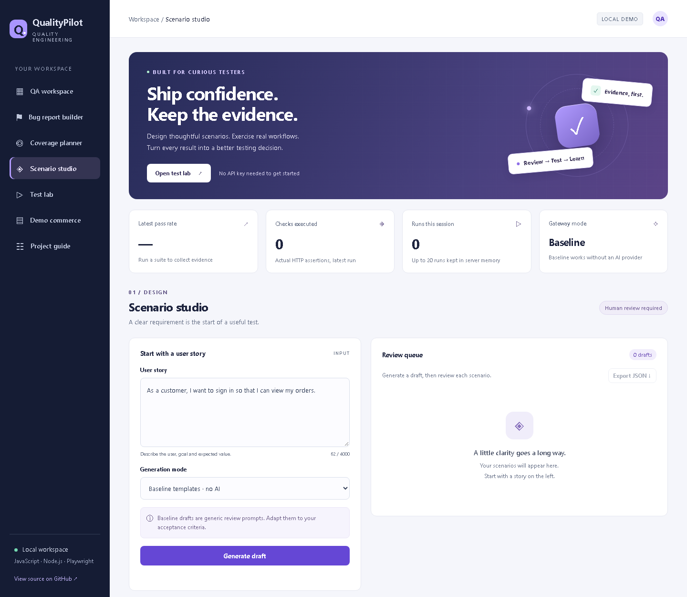
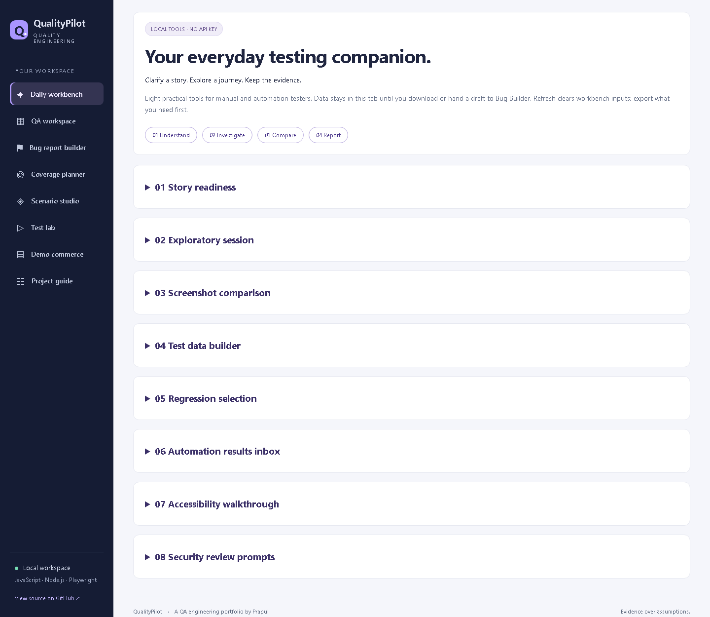
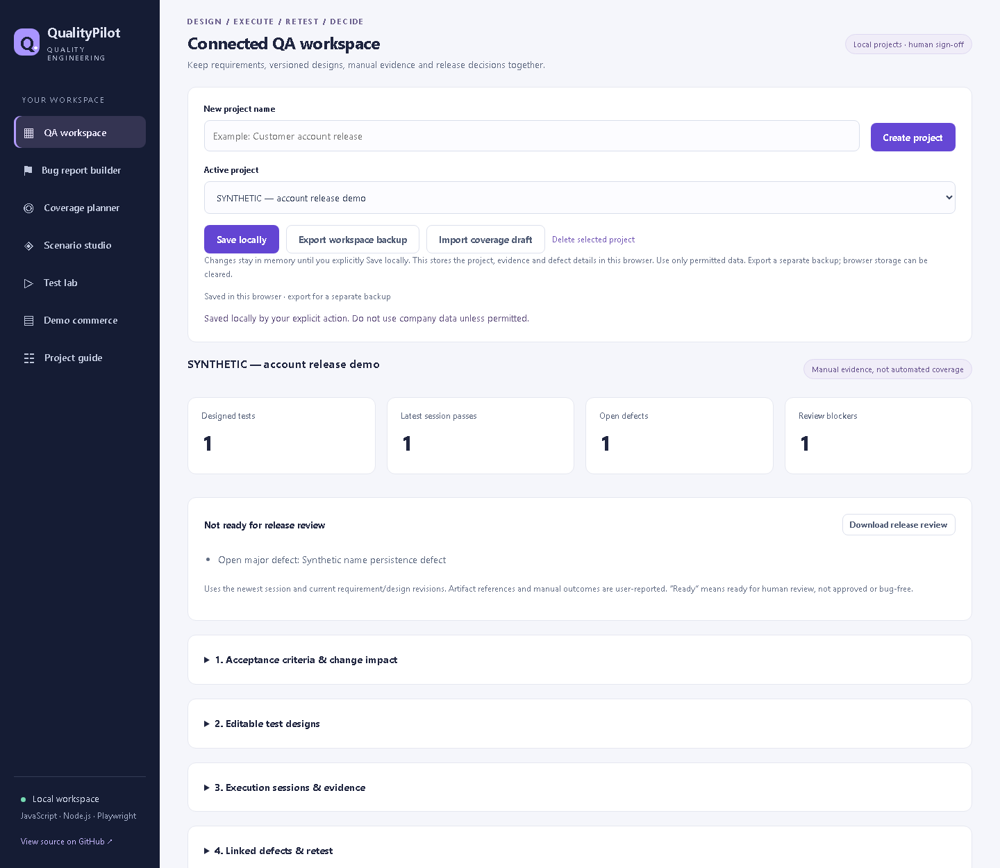
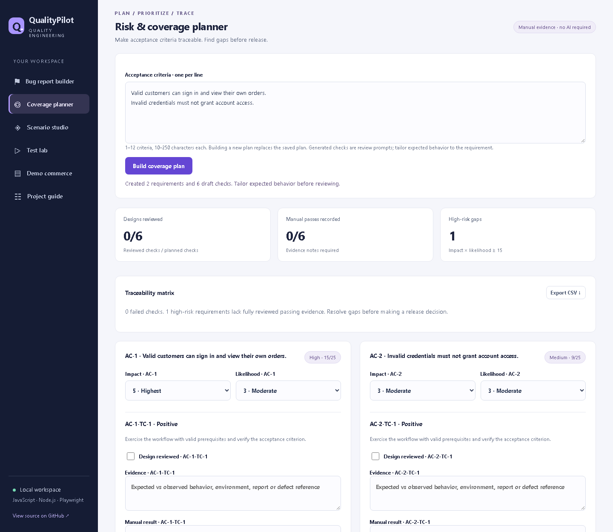
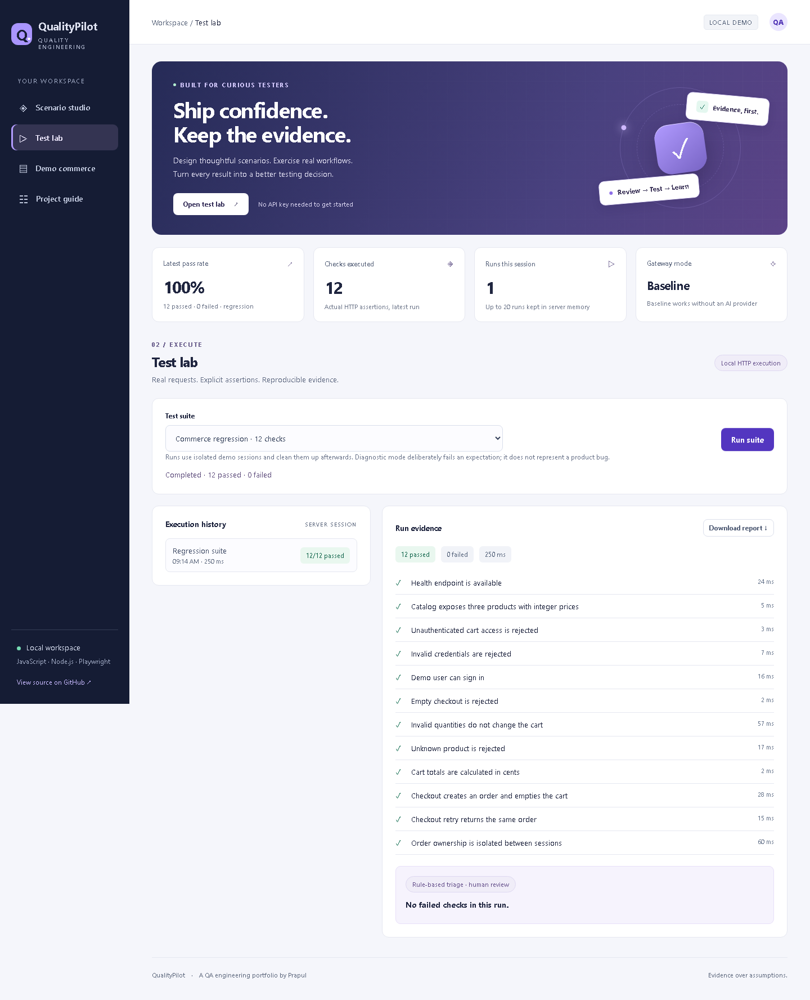
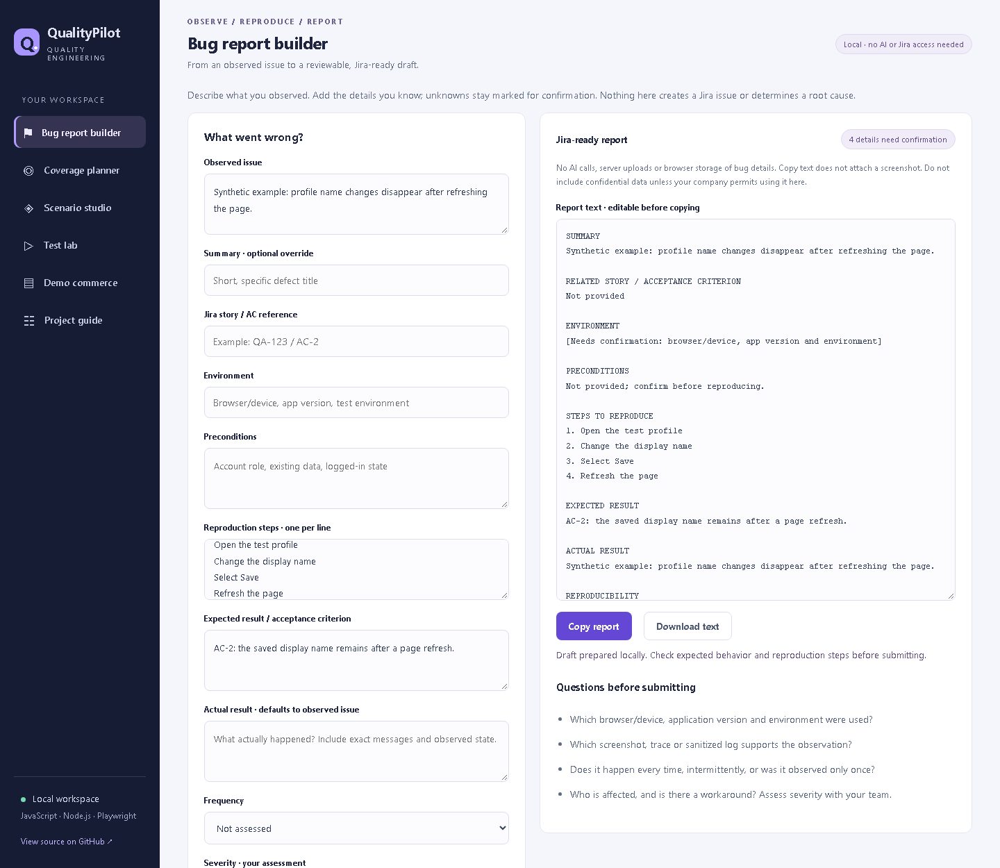
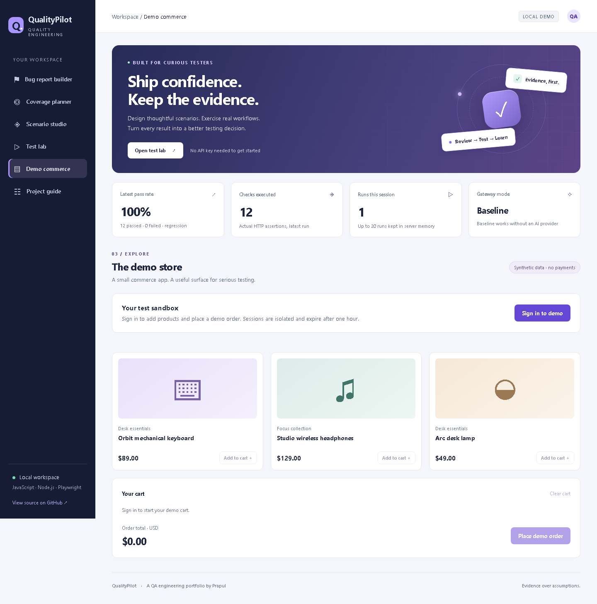
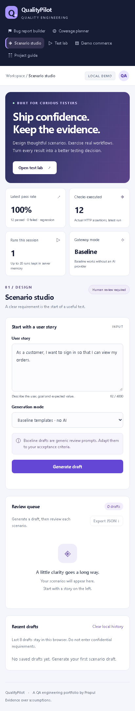
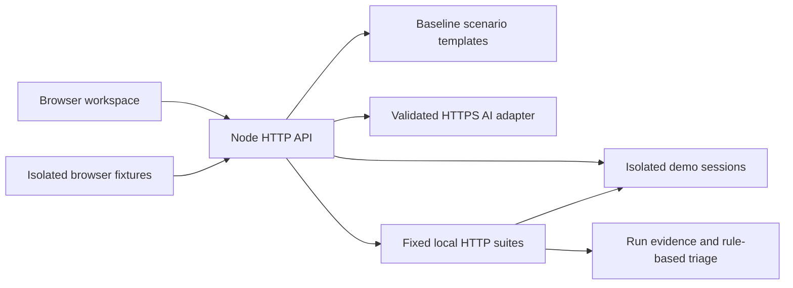

<div align="center">

# QualityPilot

### Ship confidence. Keep the evidence.

A JavaScript quality engineering workspace with scenario review, live API checks, browser automation and evidence-based failure triage.

[](https://github.com/prapulinet/qualitypilot/actions/workflows/quality.yml)


[Quick start](#quick-start) · [Quality evidence](#quality-evidence) · [Architecture](#architecture) · [Test strategy](docs/test-strategy.md)

</div>



## What you can do

**Daily Workbench (v1.2):** clarify story readiness, timebox exploratory sessions, annotate expected/actual screenshots, build boundary test data, select regression cases by declared tags, compare JUnit/Playwright reports, and record guided accessibility/security observations. Local tools connect findings to the existing Bug Builder. No AI key or Jira access is required. [Workflow, limits and interview demo](docs/daily-workbench.md).



**Connected QA Workspace (v1.1):** manage local projects, acceptance-criterion revisions, editable/reviewed designs, session snapshots, observed results, linked defects and passing retests. Derive a human release-review report from current evidence. Import Coverage planner drafts and hand failed-session details to the Bug Report Builder. [Architecture and walkthrough](docs/connected-workspace.md).



**Local Bug Report Builder:** describe an observed issue, enter known expected/actual behavior, and prepare an editable Jira-ready report. Missing details stay marked for confirmation. Copy/download the text and attach screenshots manually in Jira. No AI or Jira access is required; bug inputs and screenshot previews are not uploaded or persisted by the app. [Workflow](docs/bug-builder.md).

**New: Risk & Coverage Planner.** Turn acceptance criteria into linked review prompts, score impact × likelihood, track manual evidence, surface high-risk gaps and export a formula-safe CSV traceability matrix. [Workflow and metric definitions](docs/coverage-planner.md).



| Workspace               | Working behavior                                                                                                                 |
| ----------------------- | -------------------------------------------------------------------------------------------------------------------------------- |
| **Scenario studio**     | Generate four baseline review prompts; review individually; save browser history; export JSON                                    |
| **Test lab**            | Execute fixed smoke/regression suites against real local HTTP endpoints; inspect durations and assertions; download JSON reports |
| **Demo commerce**       | Sign in, browse products, add to cart and place synthetic orders with session isolation and retry-safe checkout                  |
| **Failure triage**      | Run an explicitly labeled diagnostic exercise and inspect evidence-linked, rule-based next steps                                 |
| **Browser automation**  | Playwright tests on desktop and mobile Chromium, axe accessibility scans, HTML/JUnit reports, and retained failure artifacts     |
| **Optional AI adapter** | Connect a trusted HTTPS gateway to generate reviewable AI drafts; no key is needed for the default experience                    |

**AI provenance:** baseline drafts are generic templates, not AI output. Triage is rule-based. Live provider integration and model quality evaluation have not been performed. The app labels these boundaries explicitly.

## Quick start

For interview preparation, read the [project learning guide](docs/interview-learning-guide.md) or download its [Word version](docs/QualityPilot_Interview_and_Learning_Guide.docx). These explain the verified 1.1 baseline; the [Daily Workbench supplement](docs/daily-workbench.md) explains the 1.2 tools. The [handover notes](docs/final-handover.md) record the earlier application revision and current boundaries.

Requires Node.js **22.9+** and npm.

```sh
git clone https://github.com/prapulinet/qualitypilot.git
cd qualitypilot
npm ci
npm start
```

Open **http://127.0.0.1:3000**. No database, API key or paid service is required.

### Run the checks

```sh
npx playwright install chromium
npm run test:all
npm run report
```

`npm run report` opens the Playwright HTML report. On Linux machines outside CI, browser installation may require `npx playwright install --with-deps chromium`.

| Command                   | Purpose                                                           |
| ------------------------- | ----------------------------------------------------------------- |
| `npm test`                | Native unit, API integration and provider contract checks         |
| `npm run test:e2e`        | Desktop/mobile browser checks; fresh application state per test   |
| `npm run check`           | Syntax validation across application, test and tooling JavaScript |
| `npm run format:check`    | Consistent source formatting                                      |
| `npm run report`          | Open generated browser report                                     |
| `npm run audit:ui`        | Inspect accessibility findings across the seven views             |
| `npm run preview:capture` | Recreate real screenshots and a sample regression result          |

## Five-minute demo

1. Generate a scenario draft; mark one scenario reviewed and export the JSON.
2. Open **Test lab**, run **Commerce regression**, and inspect all 12 assertions.
3. Download the actual run result.
4. Select **Diagnostic exercise**. Its one intentional failure demonstrates the triage workflow; it is not a product defect.
5. Open **Demo commerce**, sign in and place a demo order. No payment is processed.
6. Inspect the browser test suite and generated HTML report.

## Quality evidence

Current local validation: **44 native tests + 66 browser checks passed**. Browser checks cover 33 behaviors across desktop and mobile Chromium. They include successful workflows, validation, review persistence, exports, XSS-safe rendering, checkout limits, keyboard operation and automated accessibility scans, including the expanded Daily Workbench.

Every browser test owns a fresh Node server on an ephemeral port. Tests do not depend on an external website, shared cart state or a live AI provider.

CI runs on pushes, pull requests, manual dispatch and a daily schedule. Native tests run on Node 22 and 24; the browser job uploads its HTML/JUnit reports and retained failure screenshots, videos and traces for 14 days. Scheduled tests produce evidence, not artificial contribution commits.

[View GitHub Actions](https://github.com/prapulinet/qualitypilot/actions) · [Local verification details](docs/verification.md) · [Sample real API run](docs/evidence/regression-run.json)

### Defects caught by testing

- [QP-001](docs/bugs/QP-001.md): malformed HTML made AI mode impossible to select.
- [QP-002](docs/bugs/QP-002.md): supporting text failed minimum contrast thresholds.

<details>
<summary>More application screenshots</summary>

**Test lab with actual results**



**Local Jira-ready bug report builder (synthetic example)**



**Demo commerce**



**Mobile workspace**



</details>

## Architecture



```text
src/         HTTP boundary, commerce state, suite runner, AI adapter
web/         Responsive UI, safe DOM rendering, review and export flows
test/        Native behavior, API and contract tests
e2e/         Playwright fixtures and desktop/mobile workflows
tools/       Syntax checks, accessibility audits, previews, publishing
docs/        Strategy, contracts, decisions, bug reports and real evidence
.github/     CI and review templates
```

Engineering decisions: zero runtime dependencies; integer currency; isolated carts and orders; idempotent checkout; strict static asset allowlist and CSP; sanitized upstream errors; bounded local history; fixed execution targets. Read the [architecture decisions](docs/architecture-decisions.md) and [API contract](docs/api-contract.md).

## Optional AI configuration

Copy `.env.example` to `.env`, set `AI_GATEWAY_URL` and `AI_GATEWAY_TOKEN`, and restart. `npm start` loads this local file; `.env` is ignored by Git. Use an approved gateway and synthetic requirements.

The adapter sends `POST {"story":"..."}` with bearer authorization to the configured HTTPS endpoint. It rejects redirects and uses a 15-second timeout. Expected response:

```json
{
  "scenarios": [
    {
      "title": "Reject unauthorized order access",
      "steps": ["Request an order belonging to another session"],
      "expected": "Access is denied without exposing order data"
    }
  ]
}
```

This is a gateway contract, not a direct integration with a specific model API. Automated contract tests use controlled doubles. All generated output requires human review.

## Scope and limits

This is a complete **local portfolio demonstration**, not a hosted multi-user service. Demo credentials are public fixtures. There is no real identity management, inventory or payment processing. Server run history resets on restart; browser draft history stays in local storage. Firefox, WebKit, load testing, manual screen-reader validation and real model evaluation are future work.

## Author

[Prapul](https://github.com/prapulinet)
