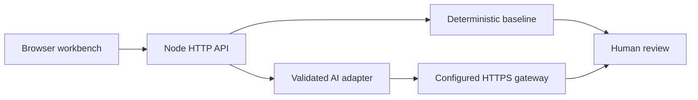

# QualityPilot

**A JavaScript QA workbench for turning requirements into reviewable test scenario drafts.**

`JavaScript ESM` · `Node.js 22+` · `API integration tests` · `GitHub Actions` · `Human-reviewed AI`

> Portfolio project in active development. Baseline generation works locally without dependencies. Live AI requires a separately configured gateway. This is not a production test execution platform.

## Run in two commands

```sh
npm test
npm start
```

Open http://127.0.0.1:3000. Paste a user story, generate a baseline draft, and review its positive, negative, boundary and access scenarios. Baseline scenarios are generic templates, not requirement-aware AI output.

## Why this project exists

A scenario generator is only useful if its outputs can be reviewed and its failures can be understood. This project makes provenance explicit, validates input at the API boundary, rejects malformed provider responses, and keeps credentials on the server.

## Architecture



| Layer | Responsibility |
| --- | --- |
| `web/index.html` | Responsive workbench, loading/error states, safe text rendering |
| `src/server.js` | Routing, input validation, body limit, sanitized errors |
| `src/scenarios.js` | Repeatable baseline templates with explicit provenance |
| `src/provider.js` | Optional gateway contract, timeout, response validation |
| `test/platform.test.js` | Behavior, boundary, API and provider contract tests |

## Optional AI integration

Set `AI_GATEWAY_URL` to a trusted HTTPS endpoint and `AI_GATEWAY_TOKEN` in your process environment, then restart the server. The application does not load `.env` files automatically. Do not commit credentials.

Gateway request: `POST` with bearer authorization and JSON `{ "story": "..." }`.

Required response:

```json
{"scenarios":[{"title":"Reject unauthorized order access","steps":["Request an order belonging to another account"],"expected":"Access is denied without exposing order data"}]}
```

Live AI has not been verified against a real provider. Automated tests use controlled gateway doubles. Provider output is always a draft; the reviewer must check relevance, missing risks and correctness.

## Quality evidence

`npm test` runs native Node tests without installing dependencies. Coverage includes story boundaries, malformed requests, media types, body size, route behavior, provider validation and sanitized upstream failures. `npm run check` checks source syntax. The included CI workflow runs both on Node 22 and 24 when pushed to GitHub; no CI pass is claimed before that run.

## Engineering decisions

- Native Node HTTP and test runner keep the first increment reproducible and easy to inspect.
- Injected gateway transport makes contract failures testable without paid API calls.
- No silent fallback from AI to templates: source and failure stay visible.
- Browser rendering uses `textContent` for generated output.
- Localhost binding keeps this unauthenticated demo local. Authentication, rate limiting, persistent storage and deployment hardening are pending.

## Roadmap — not implemented yet

- [ ] Playwright UI tests for the workbench, keyboard behavior and errors
- [ ] Demo commerce application with UI and API automation suites
- [ ] HTML execution reports and failure traces
- [ ] Human approval and saved scenario history
- [ ] AI failure analysis evaluated against labeled examples
- [ ] Downloadable demo and screenshot evidence

See [test strategy](docs/test-strategy.md), [30-day plan](docs/30-day-plan.md), and [interview walkthrough](docs/interview-walkthrough.md).
