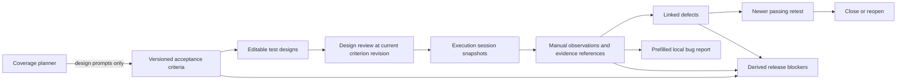

# Connected QA workspace · v1.1

## Why this increment matters

A collection of generators is useful for drafting. A quality workflow also needs traceability, version awareness, execution history and defensible decisions. This increment connects those concerns in a local application without external account access.

## Working workflow

1. Open **QA workspace**, create a named project and add acceptance criteria with impact/likelihood.
2. Create test designs with actual steps and expected behavior. Alternatively, import a Coverage planner draft; imported expected-result placeholders must be replaced before review. Imported manual pass claims are not copied.
3. Review each current design. Editing a case increments its version and resets its review. Editing a criterion/risk increments its revision and invalidates related review/evidence for release purposes.
4. Start a named execution session. It snapshots the current design and requirement revision; later design changes do not rewrite its steps or expected behavior.
5. Choose Passed, Failed or Blocked explicitly. Record observed behavior and an evidence reference. The app does not execute these manual designs or verify linked artifacts.
6. Link a defect from a failed observation with an explicit severity assessment. **Draft Jira report** transfers the known steps/expected/actual/evidence to the local builder for review; it does not submit a Jira issue.
7. After a fix, create a newer execution session. Closing a defect requires a passing result for its case against the current reviewed design. A retest supporting closure cannot be silently edited; reopen the defect first if correction is needed.
8. Inspect release blockers, then download the release-review Markdown report. Human sign-off is always required.

## Release policy

The newest session is used. Criteria without designs, unreviewed designs, missing/stale/nonpassing evidence and open Blocker/Critical/Major defects prevent readiness for release review. Open Minor/Cosmetic defects appear as warnings. These severities are tester assessments, not inferred business priorities.

“Ready for human release review” means these checks found no blockers within this plan. It is not release approval, independent evidence verification, complete product coverage or a bug-free guarantee.

## Persistence, privacy and backup

- Changes remain in memory until **Save locally** is clicked. That action explicitly stores this collection's requirements, results, evidence references and defect records in this browser.
- Export versioned JSON as a separate backup. Restore requires acknowledging replacement of the current in-memory collection. Validation reconstructs allowlisted fields, checks collection limits, enums, identifier uniqueness and links, and rejects malformed backups before replacing data.
- Imported manual claims are unverified. Schema validation is not an authenticity check.
- A shared 2 MB UTF-8 backup budget is checked before committing UI mutations. Budget errors roll the change back, keeping the collection exportable. Local-storage quota errors still require exporting a backup.
- Limits: 5 projects, 30 criteria/project, 100 designs/project, 20 sessions/project, 100 defects/project and the most recent 200 activity events/project.
- Delete requires confirmation and affects memory first. The existing browser backup changes only after a subsequent explicit save.
- Local activity records support inspection; they are not an immutable, authenticated audit trail. Browser storage is not encrypted by the app. Use only data allowed by company policy.

## Architecture decisions

**Domain layer:** `web/workspace-model.js` owns revisions, lifecycle guards, schema reconstruction, snapshots, boundary values and release policy. Native tests exercise behavior without browser dependencies.

**UI layer:** `web/workspace.js` renders text through DOM nodes and uses transactional mutation/rollback. It owns selection and persistence, not release-policy rules. Saving edited fields precedes review; status selectors never default to a passing result.

**Integrations:** Coverage draft import and bug-report handoff are local and user-triggered. The existing automated API test lab remains a separate execution source. A workspace evidence reference may point to a CI artifact, but the app does not claim to verify it.

**Future hosted edition:** a multi-user service would need identity, authorization, durable storage, concurrency controls, authenticated audit history, retention controls and operational monitoring. These are outside this local portfolio release.

## Five-minute interview demo

Create an order-ownership criterion; design a negative access test; review it; record a failure with a synthetic evidence reference; link a Major defect; show its Jira draft. Record a newer passing retest, close the defect and inspect readiness. Then change the criterion and show why old evidence becomes insufficient. Explain the distinction between a test-design version and a requirement revision.

The screenshot/sample backup under `docs/evidence/workspace-example.json` is explicitly **synthetic demonstration data**, generated to illustrate states. It is not evidence of an actual application defect or independently executed test.

## Boundary assistant

Provide inclusive integer limits to generate adjacent/minimum/maximum values. For 8–20 it returns 7, 8, 9, 19, 20 and 21. Confirm the product's real inclusive/exclusive rules before using those values.
